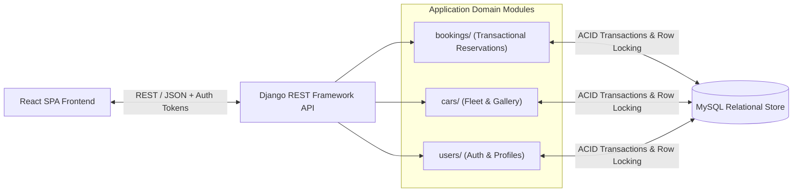

# GrandCruise — Car Rental & Reservation Platform

[](https://grandcruise-premium-cars.vercel.app)
[](https://github.com/raviteja-02/GrandCruise-Premium-Car-Rentals)

Full-stack vehicle reservation and fleet management system engineered with **Python**, **Django REST Framework**, **MySQL**, and **React**. Designed around transactional booking integrity, concurrent reservation collision prevention, and role-based fleet administration.

---

## System Architecture



---

## Core Engineering Highlights

- **Concurrent Reservation Integrity:** Prevents double-booking race conditions on overlapping date ranges using database transaction boundaries (`transaction.atomic()`) and row-level locking semantics before committing reservation state changes.
- **Modular REST API Surface:** Decoupled Django apps (`users`, `cars`, `bookings`, `car_booking`) exposing structured REST endpoints for catalog filtering, availability checks, reservation lifecycle management, and admin operations.
- **Request Validation & Access Control:** Server-side date-window validation, pricing computation, and authenticated user/admin permission guards.

---

## REST API Surface

| Endpoint Prefix | Module | Responsibility |
| :--- | :--- | :--- |
| `/api/auth/` | Authentication | Token issuance, login/logout lifecycle, and session verification |
| `/api/users/` | User Profiles | Customer registration, profile management, and role permissions |
| `/api/cars/` | Fleet Catalog | Vehicle specifications, pricing tiers, availability status, and filtering |
| `/api/car-gallery/` | Media Assets | Multi-angle vehicle imagery and gallery metadata |
| `/api/bookings/` | Reservations | Transactional booking creation, date-overlap validation, and status updates |

---

## Local Development Setup

### 1. Backend (Django REST + MySQL)

```bash
python -m venv venv
source venv/bin/activate  # Windows: venv\Scripts\activate
pip install -r requirements.txt
```

Configure `.env` in the repository root:

```env
DJANGO_SECRET_KEY=your-secret-key
DJANGO_DEBUG=True
DB_NAME=car_booking
DB_USER=root
DB_PASSWORD=your-password
DB_HOST=localhost
DB_PORT=3306
```

Run database migrations and start the API server:

```bash
python manage.py makemigrations
python manage.py migrate
python manage.py runserver
```

### 2. Frontend (React)

```bash
cd frontend
npm install
npm run dev
```
